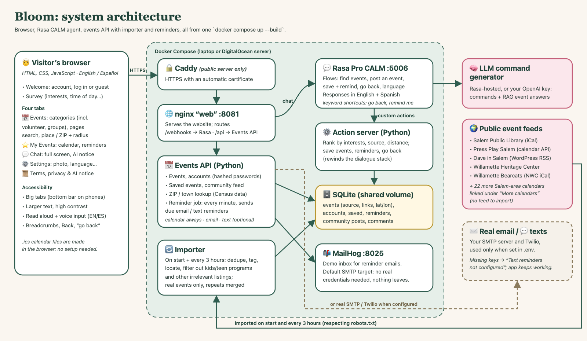
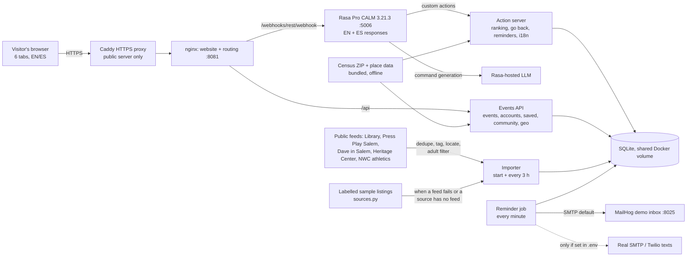

# Architecture



## Components



The importer and the reminder job run as background threads inside the events API container.

## Event search with a location

```mermaid
sequenceDiagram
    actor Visitor
    participant Browser
    participant Rasa as Rasa CALM
    participant Actions as Action server
    participant DB as SQLite
    Visitor->>Browser: "Garden events near Silverton"
    Browser->>Rasa: POST /webhooks/rest/webhook (sender id, language, survey interests)
    Rasa->>Actions: action_search_events
    Actions->>Actions: geo.parse_location → Silverton, OR (10 mi)
    Actions->>DB: every upcoming event (with lat/lon, source)
    Actions->>Actions: score interests + source weight (Center 50+, garden estates) + time; distance
    Actions-->>Rasa: "1 event within 10 miles of Silverton…" + cards (Visit website / Get tickets)
    Rasa-->>Browser: replies in the visitor's language
    Browser-->>Visitor: nearby first, the rest by distance (nothing hidden)
```

## Saving an event and getting a reminder

```mermaid
sequenceDiagram
    actor Visitor
    participant Web as Website / chat
    participant API as Events API
    participant DB as SQLite
    participant Job as Reminder job (every minute)
    participant Mail as MailHog or SMTP
    participant SMS as Twilio (optional)
    Visitor->>Web: ⭐ Save (or "Save the garden tour" in chat)
    Web->>API: POST /api/saved {owner, event_id}
    API->>DB: rsvps
    Visitor->>Web: Remind me 1 day before, by email + text
    Web->>API: POST /api/reminders {timing: 1d, channels: [email, sms]}
    API->>DB: reminders (status pending / not_configured)
    API-->>Web: email: scheduled · text: "Text reminders not configured"
    Note over Web: 📅 Add to calendar (.ics with alarm) always works, no server needed
    Job->>DB: due reminders (send_at ≤ now)
    Job->>Mail: email in the visitor's language
    Job-->>SMS: only when TWILIO_* is set; otherwise logs what it would send
```

## "Go back" in the chat

Rasa CALM keeps its place in a flow on the **dialogue stack**. When the visitor says "go back" (or taps **↩ Previous question**), a keyword shortcut starts the `go_back` flow. Its action, `action_go_back`, then:
1. finds the active flow (`create_event` or `onboarding_survey`) on the stack;
2. clears the previous answer and the current one;
3. returns a JSON-patch `stack` event that rewinds the flow to the step before the previous question.

Rasa then asks that question again. The overridden `pattern_continue_interrupted` resumes without an extra "continue?" prompt.

## Relevance and choice

Ranking is transparent and only changes the order. Every upcoming event stays visible, including low-scoring and unfamiliar ones, and search filters can always be cleared.

The order comes from:
- matches with the survey interests;
- source weights (Center 50+ for everyone, Deepwood and Lord & Schryver for gardeners);
- preferred time of day and group size;
- what was asked for;
- distance.
