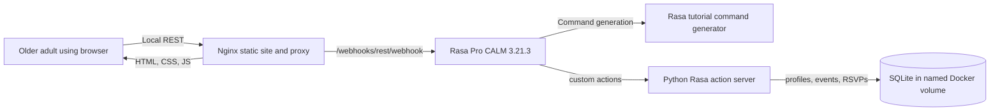

# Architecture

## Components



## Event search sequence

```mermaid
sequenceDiagram
    actor Visitor
    participant Browser
    participant Nginx
    participant Rasa as Rasa CALM
    participant Actions as Action server
    participant DB as SQLite
    Visitor->>Browser: "Find morning book clubs"
    Browser->>Nginx: POST /webhooks/rest/webhook
    Nginx->>Rasa: Forward REST message and sender id
    Rasa->>Actions: action_search_events
    Actions->>DB: Load profile and every event
    DB-->>Actions: Preferences and complete event list
    Actions->>Actions: Score overlap, time, group size; sort all
    Actions-->>Rasa: Short explanation and all event cards
    Rasa-->>Nginx: REST replies and event payload
    Nginx-->>Browser: JSON response
    Browser-->>Visitor: Accessible event cards and quick replies
```

## Relevance and choice

The action server uses transparent keyword/tag overlap, preferred time of day, and preferred group size. The ranking is only an ordering: **all events stay visible**, including low-scoring and unfamiliar options. People decide what fits them; the system does not hide an event based on an inferred preference.
