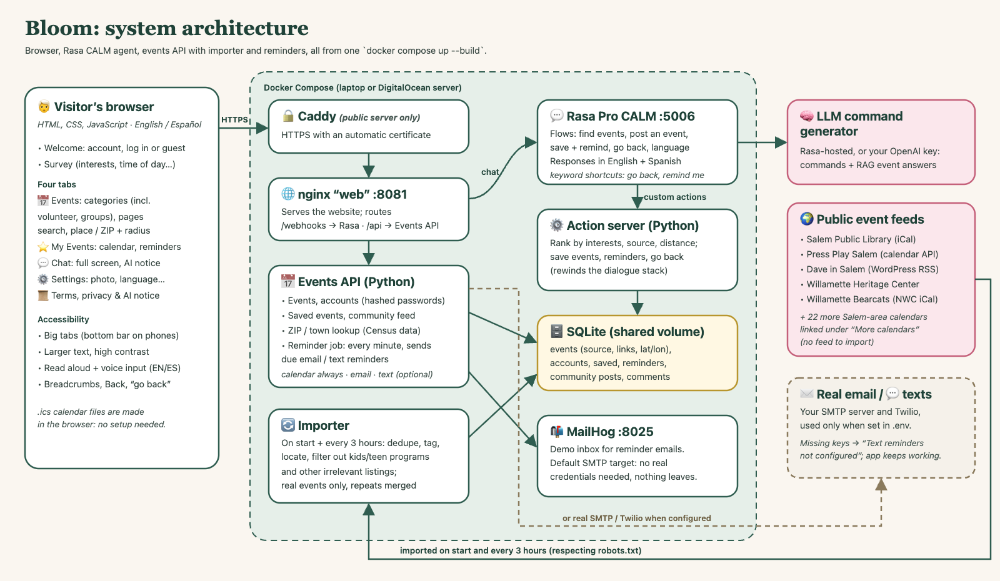

# Bloom: website update (Architecture, Setup & Community Feedback)

This is the text and images for the Google Site. Copy each section into the
site, and upload `docs/architecture.png` as the diagram image.

---

## How Bloom works

Bloom helps adults 60+ in Salem, Oregon find local events, interest groups and
volunteer opportunities, in English or Spanish. A short first-visit survey
learns what someone enjoys and when they're free. Bloom then **ranks** every
upcoming event by how well it fits, and explains why. It never hides an event,
so the person stays in control.

**The pieces**

| Part | Technology | What it does |
| --- | --- | --- |
| Website | HTML, CSS, JavaScript | Welcome page (account, log in or guest), survey, and six large tabs: Chat, Events, My Events, Volunteer, Community, Settings. English and Spanish, larger text, high contrast, read aloud, voice input. |
| Ask Bloom agent | Rasa Pro CALM 3.21 | Multi-turn conversations in English and Spanish: find events by type, day, time or place; save an event and set a reminder; post an event step by step; "go back" to change the last answer; cancel. An LLM turns free-form messages into Rasa commands. |
| Action server | Python (rasa_sdk) | Ranks events by interests, source, time and distance; checks dates, times and yes/no answers; rewinds the conversation for "go back"; saves events and reminders. |
| Events API | Python | Events board, accounts (email + display name; passwords salted and hashed), saved events, community groups with joins and comments, ZIP/town lookup, and the reminder job. |
| Importer | Python, on start and every 3 hours | Pulls public feeds (Salem Public Library, Press Play Salem, Dave in Salem, Willamette Heritage Center, Willamette Bearcats), removes children's and teen programs, tags and locates each event, and fills gaps with clearly labelled sample listings. |
| Location data | U.S. Census gazetteer (bundled) | Every U.S. ZIP code and town, so place and ZIP + radius search work offline. |
| Reminders | Calendar files, SMTP, Twilio | .ics calendar reminders always work. Email goes to the bundled MailHog demo inbox unless real SMTP is configured; text messages are optional (Twilio). |
| Database | SQLite (Docker volume) | One shared store, so an event saved or posted in the chat shows up on the website right away. |
| Hosting | Docker Compose; Caddy HTTPS on DigitalOcean | One command locally; an always-on public link. |

## Setup overview

**Try it live:** <https://206-189-212-135.sslip.io>

**Run it yourself.** You need Docker Desktop and a Rasa Pro developer license. Nothing else is required.

1. `git clone https://github.com/Sebdeisenhofer/Bloom.git && cd Bloom`
2. `cp .env.example .env`, then paste your license after `RASA_PRO_LICENSE=`
3. `docker compose up --build`
4. Open <http://localhost:8081>. Reminder emails appear at <http://localhost:8025>.

**Demo login:** `demo@bloom.local` / `demo`, or open the site with `?demo`.

**Optional services:** real email (SMTP) and text messages (Twilio) are set in
`.env`. Without them Bloom still runs and says plainly that those reminders are
not configured.

**Tests:** 54 unit tests and 26 end-to-end conversation tests, including
location search, ZIP + radius, "go back", reminders and Spanish.

---

## Community Feedback

Bloom was reviewed by a Salem local who ran the **Dave in Salem** events blog,
and our teammate ran user testing with older adults. Here is what they told us
and what we changed in response.

**What testers liked (kept):** the warm look and the emoji greetings, choosing a
preferred time of day, and seeing events from several sources.

**What they suggested, and what we changed:**

1. **"The giant block of events isn't working."**
   - Bloom now has six large tabs: Chat, Events, My Events, Volunteer, Community and Settings. Each is at least 60 px tall and works with the keyboard and screen readers.
   - Every page has breadcrumbs and a Back button.
   - Events are grouped under date headings, 10 at a time.
   - Filters cover kind of event, date (today, this week, this weekend, a chosen date), time of day, place and source.
2. **"Use the places Salem people actually check."** Events and listings now come from:
   - Center 50+, which ranks highest
   - Dave in Salem
   - Press Play Salem
   - Salem Reporter
   - Salem Public Library
   - Willamette Heritage Center
   - Deepwood Museum & Gardens
   - Lord & Schryver Conservancy
   - Willamette University
   - Travel Salem
   - Salem Art Association
   - Elsinore Theatre

   Public feeds are imported automatically. Sources without a feed show clearly labelled sample listings that link to the real website. Every event has **Visit website**, plus **Get tickets** when tickets apply. Gardeners see Deepwood and Lord & Schryver first.
3. **"Let me look somewhere else, like the coast or Portland."**
   - Search by town or region name, or by ZIP code within 5, 10, 25 or 50 miles. This works in the chat and in the Events tab.
   - Nearby events come first, and nothing is hidden.
4. **"Volunteering deserves its own place."** A dedicated Volunteer tab, plus sample volunteer shifts at Deepwood, Lord & Schryver and Meals on Wheels.
5. **"People want to start groups, like a French conversation group."**
   - The Community tab lets neighbors post meetups by interest, and others can join or comment.
   - "Language & conversation groups" is now an interest in the survey and in Events.
6. **"Help me remember."**
   - My Events has calendar files that work everywhere.
   - Email reminders are demoed with MailHog, and text reminders work when Twilio is set up.
   - Reminders can go 1 day or 2 hours before an event.
   - In the chat you can say "Save the garden tour", then "remind me a day before".
7. **"Let me fix my last answer."** In the chat, "go back" or the **↩ Previous question** button returns to the last question so you can change it.
8. **"Not everyone is most comfortable in English."**
   - Spanish runs throughout: the website, every assistant message, and voice input and read-aloud.
   - A language picker is on the welcome page and in Settings.
9. **Accounts and accountability.**
   - Sign in with any email and a display name.
   - Guests can still browse, and their saves move into the account when they sign up.
   - Shared events show who posted them, and events reported by several people are hidden.

---

## Screenshots to add to the site

1. The welcome page with the English / Español picker
2. The Chat tab answering "Garden events near Silverton", with Visit website buttons
3. The Events tab: filters, date headings and "Show 10 more"
4. A sample listing card with its "Sample listing" note
5. My Events with the reminder panel (1 day / 2 hours, email / text)
6. The MailHog inbox showing a reminder email
7. The Community tab with the French conversation group
8. The Volunteer tab
9. The chat in Spanish, including "volver atrás"
10. Settings with larger text and high contrast turned on
