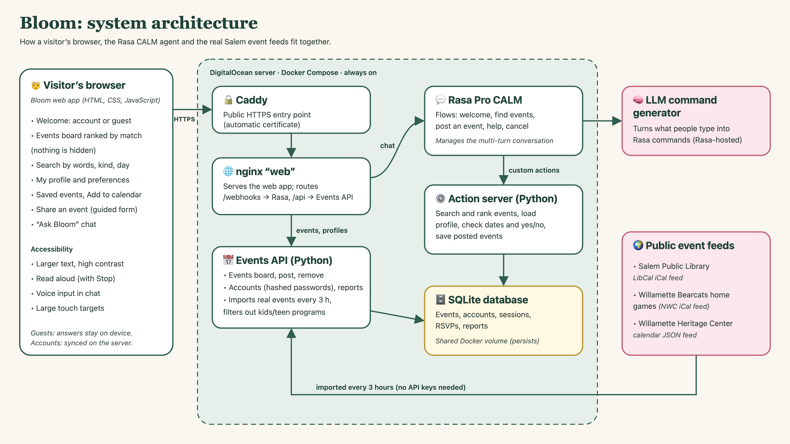

# Bloom: website update (Architecture & Setup page)

This is the text and images for the **Architecture diagram and setup overview**
part of the Google Site. Copy each section into the site, and upload
`docs/architecture.png` as the diagram image.

---

## How Bloom works

Bloom helps adults 60+ in Salem, Oregon find local events and connect with
neighbors. A short first-visit survey learns what someone enjoys and when
they're free. Bloom then **ranks** every upcoming event by how well it fits,
and explains why. It never hides an event, so the person stays in control.

**The pieces**

| Part | Technology | What it does |
| --- | --- | --- |
| Web app | HTML, CSS, JavaScript | Welcome page (create account, log in or continue as guest), survey, ranked events board, search, profile, saved events, add to calendar, share-an-event form. Larger text, high contrast, read aloud and voice input. |
| Ask Bloom agent | Rasa Pro CALM 3.21 | Multi-turn conversations: finding events, posting an event step by step (with confirmation), help and cancel. An LLM turns free-form messages into Rasa commands. |
| Action server | Python (rasa_sdk) | Searches and ranks events, checks dates, times and yes/no answers, and saves posted events only after they are verified. |
| Events API | Python | Serves the events board, accounts (salted, hashed passwords; preferences and saved events follow you to any device), posted events, and reports of fake or unsafe events. Only signed-in accounts can share events. |
| Real event import | Python, every 3 hours | Pulls Salem Public Library events, Willamette Bearcats home games and Willamette Heritage Center events, then filters out children's and teen programs. |
| Database | SQLite (Docker volume) | One shared store, so an event posted in the chat or on the website shows up everywhere right away. |
| Hosting | Docker Compose on DigitalOcean, Caddy for HTTPS | Always-on public link. |

## Setup overview

**Try it live:** <https://206-189-212-135.sslip.io>

**Run it yourself** (needs Docker Desktop and a free Rasa Pro developer license):

1. `git clone https://github.com/Sebdeisenhofer/Bloom.git && cd Bloom`
2. `cp .env.example .env`, then paste your license after `RASA_PRO_LICENSE=`
3. `docker compose up --build`
4. Open <http://localhost:8081>. The first start trains the agent, which
   takes a few minutes.

**Put it online:** `deploy/setup-server.sh` installs everything on a fresh
Ubuntu server and sets up HTTPS. See `docs/deploy-digitalocean.md`.

**Demo login:** username `demo`, password `demo` (or open the site with `?demo`).

**Tests:** 25 unit tests (`tests/test_actions.py`) and Rasa end-to-end
conversation tests (`tests/e2e_tests.yml`).

---

## Screenshots to add to the site

1. The welcome page (Create account / Log in / Continue as guest)
2. The first-visit survey (interest checkboxes)
3. The home page: top picks with "Why we suggested this"
4. Search: for example "basketball", or a kind of event plus "Next 7 days"
5. My profile page
6. An event card with **Add to calendar** opened
7. My saved events
8. The Ask Bloom chat answering "What's on this week?"
9. Posting an event in the chat, with the Yes/No confirmation
10. Large text or high contrast mode turned on
